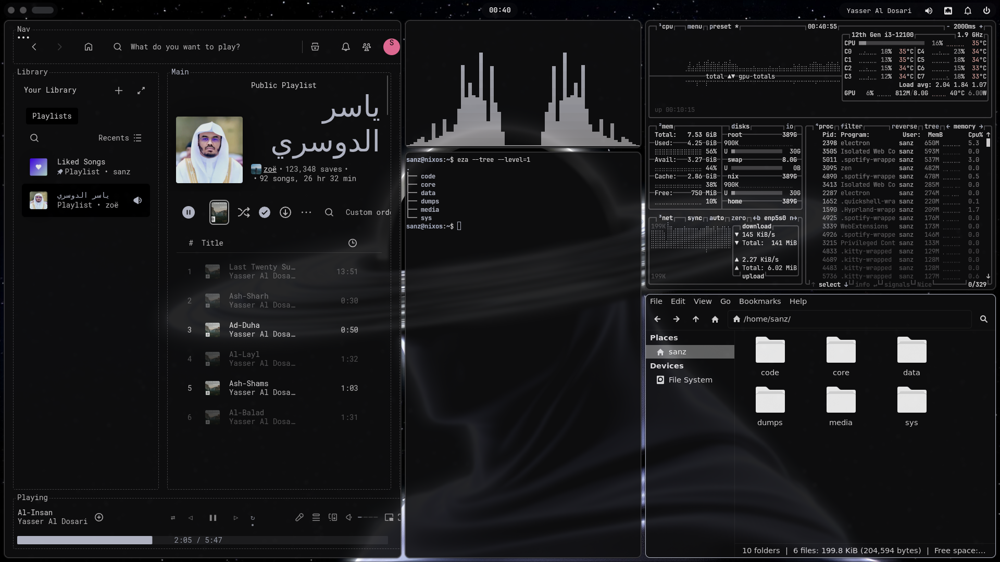
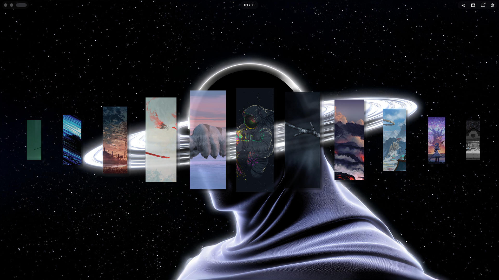
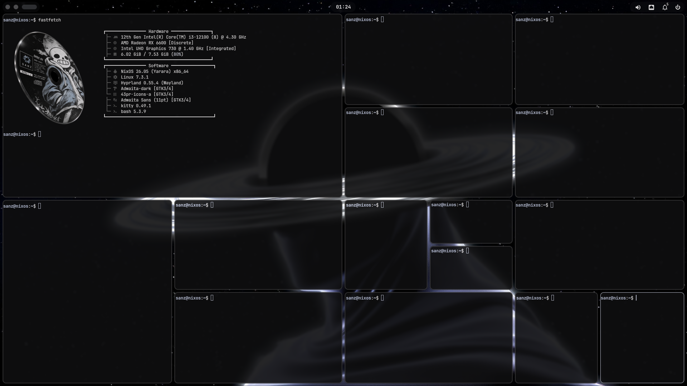

# NIXULARITY

Somehow, this code works. Only God knows how.

My personal NixOS configuration, built with Nix Flakes, Home Manager, Hyprland, and Quickshell.

The desktop is based on the visual design of [43PR's dotfiles](https://github.com/43PR/dotfiles), adapted for my NixOS environment.

## Preview

### Desktop



### Gallery

| Preview 04 | Preview 05 |
|:---:|:---:|
|  |  |

## Features

- NixOS 26.05
- Nix Flakes and Home Manager
- Hyprland with Lua configuration
- Quickshell desktop interface
- Dynamic themes and color palettes
- Hyprlock
- Spotify with Spicetify
- Dynamic Spotify colors synchronized with the desktop palette
- Kitty, Rofi, Cava, and GTK theming
- Custom media controls and desktop utilities

## Project Structure

```text
.
├── flake.nix
├── flake.lock
├── configuration.nix
├── hardware-configuration.nix
├── hosts/
│   └── nixos/
├── modules/
│   ├── desktop/
│   ├── hardware/
│   ├── programs/
│   └── system/
└── home/
    ├── 43pr/
    ├── cava/
    ├── gtk-3.0/
    ├── gtk-4.0/
    ├── hypr/
    ├── kitty/
    ├── matugen/
    ├── quickshell/
    ├── rofi/
    ├── spicetify/
    └── sanz.nix
```

## Installation

> [!WARNING]
> This is a personal system configuration, not a universal NixOS installer.
> Review and adapt the hardware configuration, boot settings, username,
> hostname, file paths, and GPU configuration before applying it.

Clone the repository into your NixOS configuration directory.

Check the system build:

```bash
nix build --no-link \
  .#nixosConfigurations.nixos.config.system.build.toplevel
```

After adapting the configuration to your hardware, you can activate it with:

```bash
sudo nixos-rebuild switch --flake .#nixos
```

## Theme System

The theme engine lives in `home/43pr/`.

It generates colors for:

- Hyprland and Hyprlock
- Quickshell
- Kitty and Rofi
- GTK
- Btop and Cava
- Spotify

Generated colors are stored in writable XDG configuration and cache directories.

## Credits

- [43PR/dotfiles](https://github.com/43PR/dotfiles) — original desktop design and configuration components.
- [Spicetify](https://spicetify.app/) — Spotify customization.

This repository includes components adapted from 43PR's MIT-licensed project.
See [LICENSE](LICENSE).
